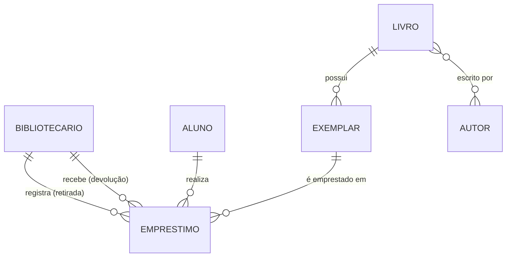

# Archivum — Modelo de Dados

> **Fonte de verdade do domínio de dados.** Tabelas, colunas, relações e enums definidos
> aqui orientam as migrations e os models. Alterações no domínio devem **começar por este
> documento**.

## 1. Convenções

- **Tabelas**: português, **singular**, `snake_case` (`livro`, `emprestimo`).
- **Colunas**: `snake_case` em português. Exceções mantidas em inglês por decisão de
  produto: `role`.
- **Models**: PascalCase em `app/models/*.ts`, com `static table` **explícito** (o Lucid
  pluralizaria o nome da classe por padrão).
- **PK**: `id` (`increments`). **Timestamps**: `created_at` (not null) e `updated_at`
  (null), preenchidos pelo Lucid.
- **Chaves estrangeiras**: `<entidade>_id`. Empréstimos referenciam um **exemplar**, nunca
  o livro diretamente.
- **Tabela pivô**: `autor_livro` (ordem alfabética dos models, padrão do Lucid), com PK
  composta.
- **Enums de domínio**: constantes TypeScript (colunas `varchar`), não tipos nativos do
  Postgres.

## 2. Relacionamentos

- `livro` (obra) 1—N `exemplar` (cópia física emprestável).
- `livro` N—N `autor` através de `autor_livro`.
- `emprestimo` pertence a `exemplar`, `aluno` e a **dois** bibliotecários: o que registrou
  a retirada e o que recebeu a devolução.

## 3. Tabelas

### 3.1 `bibliotecario`

Usuário do sistema (substitui a tabela `users` do scaffold).

| coluna     | tipo         | regras                            |
| ---------- | ------------ | --------------------------------- |
| id         | increments   | PK                                |
| nome       | varchar(120) | not null                          |
| matricula  | varchar(6)   | not null, unique                  |
| email      | varchar(254) | not null, unique (login)          |
| senha      | varchar      | not null, oculta na serialização  |
| role       | varchar(20)  | not null, default `bibliotecario` |
| ativo      | boolean      | not null, default `true`          |
| created_at | timestamp    | not null                          |
| updated_at | timestamp    | null                              |

### 3.2 `aluno`

Registro de aluno. Sem login, conta ou reserva.

| coluna      | tipo         | regras                   |
| ----------- | ------------ | ------------------------ |
| id          | increments   | PK                       |
| nome        | varchar(120) | not null                 |
| matricula   | varchar(20)  | not null, unique         |
| ano_escolar | integer      | not null                 |
| turma       | varchar(1)   | not null (a, b, c, d…)   |
| nivel       | varchar(20)  | not null                 |
| email       | varchar(254) | null                     |
| telefone    | varchar(20)  | null                     |
| ativo       | boolean      | not null, default `true` |
| created_at  | timestamp    | not null                 |
| updated_at  | timestamp    | null                     |

### 3.3 `autor`

| coluna     | tipo         | regras   |
| ---------- | ------------ | -------- |
| id         | increments   | PK       |
| nome       | varchar(120) | not null |
| created_at | timestamp    | not null |
| updated_at | timestamp    | null     |

### 3.4 `livro` (obra)

| coluna         | tipo         | regras       |
| -------------- | ------------ | ------------ |
| id             | increments   | PK           |
| titulo         | varchar(200) | not null     |
| isbn           | varchar(20)  | null, unique |
| editora        | varchar(120) | null         |
| ano_publicacao | integer      | null         |
| created_at     | timestamp    | not null     |
| updated_at     | timestamp    | null         |

### 3.5 `exemplar` (cópia física)

| coluna     | tipo        | regras                                                 |
| ---------- | ----------- | ------------------------------------------------------ |
| id         | increments  | PK                                                     |
| livro_id   | integer     | not null, FK `livro(id)` on delete **restrict**, index |
| codigo     | varchar(30) | not null, unique (tombo)                               |
| situacao   | varchar(20) | not null, default `disponivel`, index                  |
| created_at | timestamp   | not null                                               |
| updated_at | timestamp   | null                                                   |

### 3.6 `autor_livro` (pivô N—N)

| coluna   | tipo    | regras                                         |
| -------- | ------- | ---------------------------------------------- |
| livro_id | integer | not null, FK `livro(id)` on delete **cascade** |
| autor_id | integer | not null, FK `autor(id)` on delete **cascade** |
| —        | —       | PK composta `(livro_id, autor_id)`             |

### 3.7 `emprestimo`

| coluna                     | tipo        | regras                                                                             |
| -------------------------- | ----------- | ---------------------------------------------------------------------------------- |
| id                         | increments  | PK                                                                                 |
| exemplar_id                | integer     | not null, FK `exemplar(id)` restrict, index                                        |
| aluno_id                   | integer     | not null, FK `aluno(id)` restrict, index                                           |
| bibliotecario_retirada_id  | integer     | not null, FK `bibliotecario(id)` restrict, index — quem **cadastrou** o empréstimo |
| bibliotecario_devolucao_id | integer     | null, FK `bibliotecario(id)` restrict — quem **recebeu** o livro de volta          |
| data_retirada              | date        | not null                                                                           |
| data_prevista_devolucao    | date        | not null, index                                                                    |
| data_devolucao             | date        | null                                                                               |
| renovacoes                 | integer     | not null, default 0                                                                |
| status                     | varchar(20) | not null, default `ativo`, index                                                   |
| created_at                 | timestamp   | not null                                                                           |
| updated_at                 | timestamp   | null                                                                               |

## 4. Enums de domínio

Definidos como constantes TypeScript nos respectivos models.

| Model           | Enum        | Valores                                                |
| --------------- | ----------- | ------------------------------------------------------ |
| `Bibliotecario` | `roles`     | `admin`, `bibliotecario`                               |
| `Aluno`         | `niveis`    | `fundamental`, `medio`                                 |
| `Exemplar`      | `situacoes` | `disponivel`, `emprestado`, `extraviado`, `danificado` |
| `Emprestimo`    | `statuses`  | `ativo`, `devolvido`                                   |

**Sincronização da situação do exemplar:** ao registrar um empréstimo o exemplar passa a
`emprestado`; ao devolver, volta a `disponivel`. Um exemplar está **disponível** quando
`situacao = 'disponivel'`.

## 5. Relações nos models (Lucid)

| Model           | Relação                  | Tipo                      | Observação                             |
| --------------- | ------------------------ | ------------------------- | -------------------------------------- |
| `Bibliotecario` | `emprestimosRegistrados` | hasMany `Emprestimo`      | `foreignKey: bibliotecarioRetiradaId`  |
| `Bibliotecario` | `emprestimosRecebidos`   | hasMany `Emprestimo`      | `foreignKey: bibliotecarioDevolucaoId` |
| `Aluno`         | `emprestimos`            | hasMany `Emprestimo`      |                                        |
| `Autor`         | `livros`                 | belongsToMany `Livro`     | `pivotTable: autor_livro`              |
| `Livro`         | `autores`                | belongsToMany `Autor`     | `pivotTable: autor_livro`              |
| `Livro`         | `exemplares`             | hasMany `Exemplar`        |                                        |
| `Exemplar`      | `livro`                  | belongsTo `Livro`         |                                        |
| `Exemplar`      | `emprestimos`            | hasMany `Emprestimo`      |                                        |
| `Emprestimo`    | `exemplar`               | belongsTo `Exemplar`      |                                        |
| `Emprestimo`    | `aluno`                  | belongsTo `Aluno`         |                                        |
| `Emprestimo`    | `bibliotecarioRetirada`  | belongsTo `Bibliotecario` | `foreignKey: bibliotecarioRetiradaId`  |
| `Emprestimo`    | `bibliotecarioDevolucao` | belongsTo `Bibliotecario` | `foreignKey: bibliotecarioDevolucaoId` |

## 6. Perfis e permissões

Dois papéis em `bibliotecario.role`: **`admin`** e **`bibliotecario`**. Todo `admin` pode
executar **todas** as ações de um `bibliotecario` (o `bibliotecario` é subconjunto do
`admin`).

| Ação                                             | `bibliotecario` | `admin` |
| ------------------------------------------------ | :-------------: | :-----: |
| Login / logout                                   |       ✅        |   ✅    |
| Consultar alunos, acervo e empréstimos           |       ✅        |   ✅    |
| Cadastrar / editar aluno                         |       ✅        |   ✅    |
| **Desativar / reativar aluno**                   |       ❌        |   ✅    |
| Cadastrar / editar livro, autor, exemplar        |       ✅        |   ✅    |
| **Excluir** livro, autor, exemplar               |       ✅        |   ✅    |
| Registrar empréstimo, renovar, devolver          |       ✅        |   ✅    |
| **Cadastrar / editar / desativar bibliotecário** |       ❌        |   ✅    |
| **Definir `role` de um bibliotecário**           |       ❌        |   ✅    |

Regras complementares:

- Um `bibliotecario` comum **não pode criar, editar, desativar nem alterar o `role`** de
  outros bibliotecários.
- Um `bibliotecario` comum **não pode desativar alunos** (cadastrar/editar continua
  permitido).
- Um `admin` **não pode desativar a si mesmo** nem remover o próprio `role = admin`.

### Onde a regra vive

- Enforçada na **camada de aplicação** (middleware de rota / verificação de papel no
  controller), **não** no banco.
- A adoção de `@adonisjs/bouncer` (ACL) fica para quando os controllers existirem; aqui
  apenas fixamos o modelo de permissões como fonte de verdade.

## 7. Fora de escopo (nesta versão)

Login/conta/reserva de aluno, controle de feriados, histórico de renovações, multas,
relatórios, tabela de `role` com múltiplos papéis.
